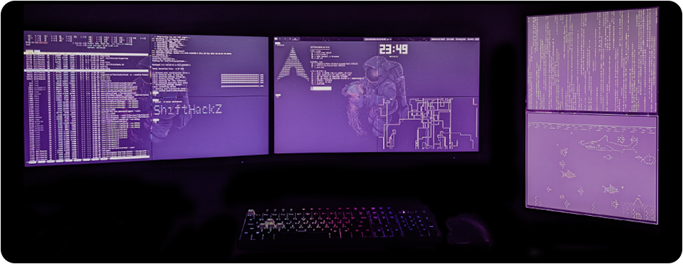
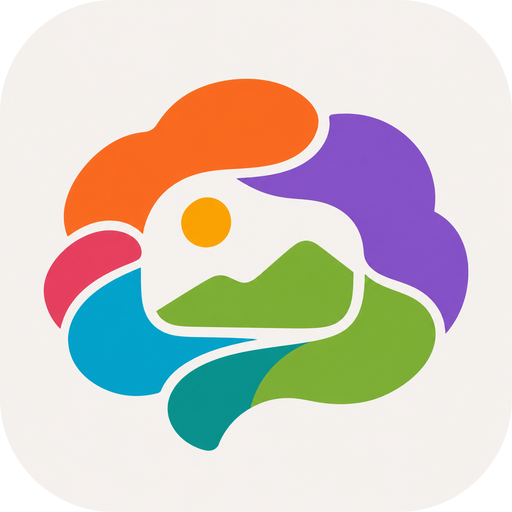
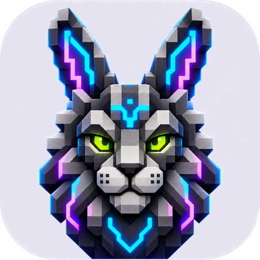
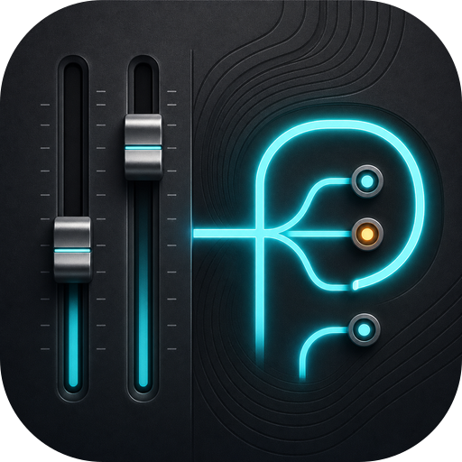
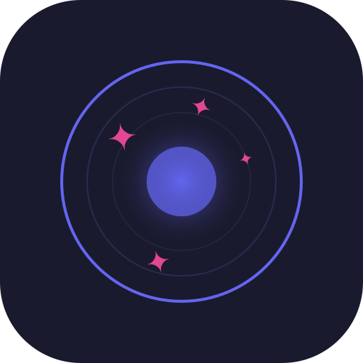

##  About me:

👋 Hi, I’m Dmitriy Moroz (aka [ShiftHackZ](https://github.com/ShiftHackZ), [D10G3N](https://d10g3n.live)).

⭐️ An Open Source advocate.

🚀 Full-stack architect: Android, iOS, cross-platform apps, web, backend & AI tooling.

🌱 Education: Ph.D. in Computer Science.

##  How to contact me:

✉️ Email: <a href="mailto:dmitriy@moroz.cc">dmitriy@moroz.cc</a>

##  My projects:

<table>
  <tr>
    <td align="center" valign="top" width="33%">
      
        
      <a href="https://moroz.cc"><strong>Moroz Inc.</strong></a>
      
Web, mobile & AI products.

    </td>
    <td align="center" valign="top" width="33%">
      
        
      <a href="https://sdai.moroz.cc"><strong>SDAI</strong></a>
      
AI art for Android & iOS.

    </td>
    <td align="center" valign="top" width="33%">
      
        
      <a href="https://github.com/ShiftHackZ/ellmsha"><strong>eLLMsha</strong></a>
      
AI agents & project memory.

    </td>
  </tr>
  <tr>
    <td align="center" valign="top" width="33%">
      
        
      <a href="https://xavucontrol.moroz.cc"><strong>Xavucontrol</strong></a>
      
Audio routing for macOS.

    </td>
    <td align="center" valign="top" width="33%">
      
        
      <a href="https://d10g3n.live"><strong>D10G3N Live</strong></a>
      
Original music. Albums & tracks.

    </td>
    <td align="center" valign="top" width="33%">
      
        
      <a href="https://github.com/ShiftHackZ/WooCommerceMobile"><strong>WooApp</strong></a>
      
WooCommerce shops on mobile.

    </td>
  </tr>
</table>

<!-- Store links kept here for reference; hidden from the profile.

-->

##  Technical stack:

#### 📱 Mobile

#### 🌐 Web & backend

#### 🧠 AI & machine learning

#### ☁️ Infrastructure

#### 🛠 Developer tools

##  Statistics:

 

<!---
ShiftHackZ/ShiftHackZ is a ✨ special ✨ repository because its `README.md` (this file) appears on your GitHub profile.
You can click the Preview link to take a look at your changes.
--->
